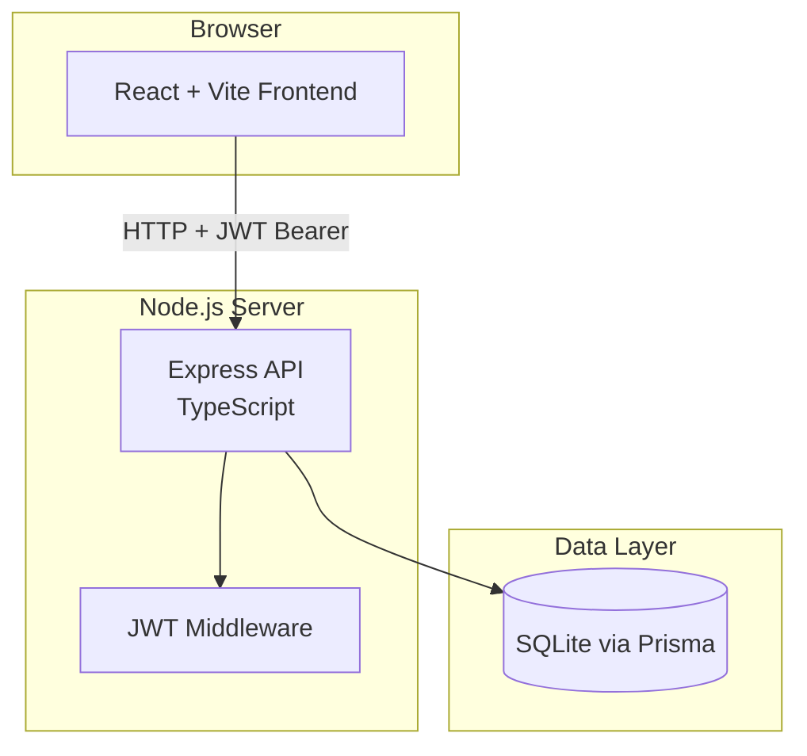
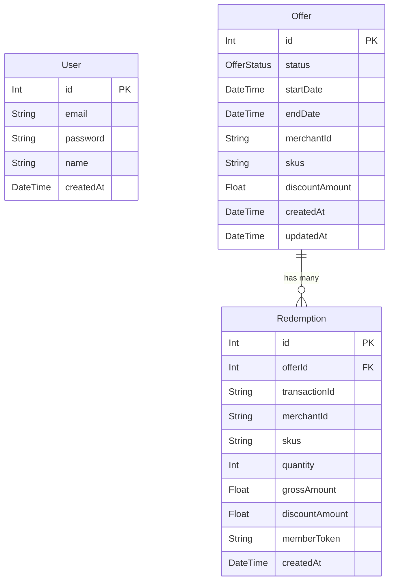
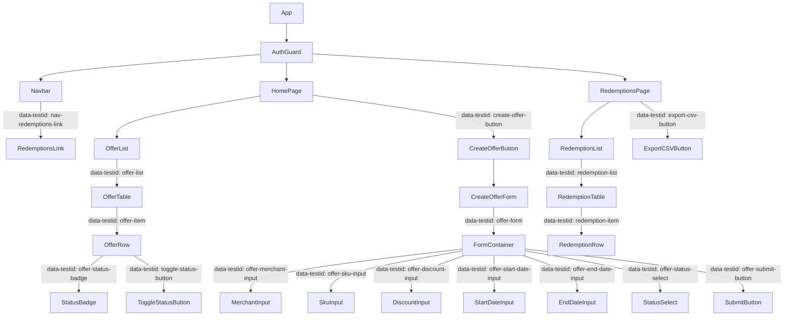
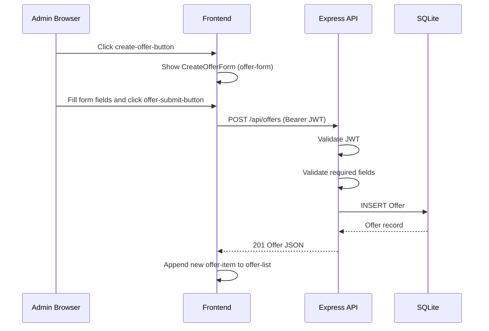
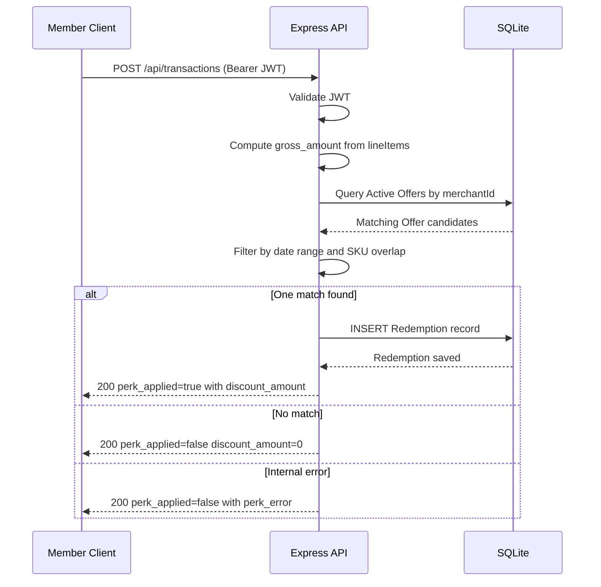
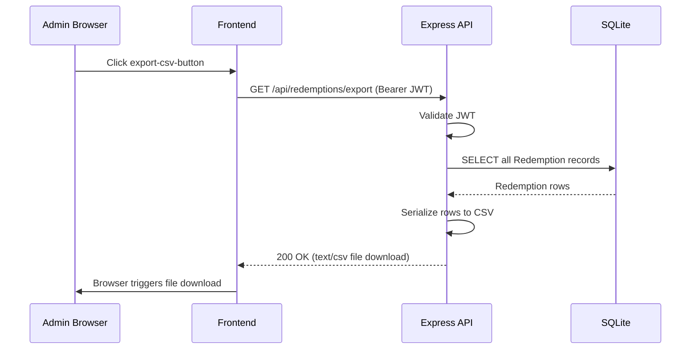

# Perk Application Platform — Design Document
**Date:** 2026-03-20
**Source:** BRD.md + User Story Issues

---

## 1. Architecture Overview

The platform is a three-tier web application: a React/Vite frontend, a Node.js/Express/TypeScript backend API, and an SQLite database managed via Prisma ORM.



**Data flow:**
- All API calls carry a JWT Bearer token; the pre-built `auth.ts` middleware validates it on every protected route.
- The frontend calls `/api/offers` for Offer management and `/api/redemptions` for reconciliation.
- `POST /api/transactions` is the core Perk-application endpoint — it evaluates Active Offers and writes Redemption records.

---

## 2. Data Model

### 2.1 Prisma Schema

```prisma
// PRE-BUILT — do not modify
model User {
  id        Int      @id @default(autoincrement())
  email     String   @unique
  password  String
  name      String
  createdAt DateTime @default(now())
}

// NEW
enum OfferStatus {
  ACTIVE
  INACTIVE
}

// NEW
model Offer {
  id             Int          @id @default(autoincrement())
  status         OfferStatus  @default(INACTIVE)
  startDate      DateTime
  endDate        DateTime
  merchantId     String
  skus           String
  discountAmount Float
  createdAt      DateTime     @default(now())
  updatedAt      DateTime     @updatedAt
  redemptions    Redemption[]
}

// NEW
model Redemption {
  id             Int      @id @default(autoincrement())
  offerId        Int
  transactionId  String
  merchantId     String
  skus           String
  quantity       Int
  grossAmount    Float
  discountAmount Float
  memberToken    String
  createdAt      DateTime @default(now())
  offer          Offer    @relation(fields: [offerId], references: [id])
}
```

### 2.2 ER Diagram



**Design decisions:**
- `Offer.skus` is stored as a comma-separated `String` (per issue spec) — parsing is done in the Perk evaluation service.
- `OfferStatus` enum enforces `ACTIVE`/`INACTIVE` at the ORM level; Prisma maps to a string column in SQLite.
- `Redemption` has no `updatedAt` — records are immutable once created (NFR-004, FR-006).
- `memberToken` is a SHA-256 hex digest of the Member's `memberId` (assumption from BRD §7).

---

## 3. API Endpoints

| Method | Path | Description | Auth Required |
|--------|------|-------------|---------------|
| POST | `/api/auth/register` | Register a new user | No |
| POST | `/api/auth/login` | Login, returns JWT | No |
| POST | `/api/offers` | Create a new Offer | Yes (Admin JWT) |
| GET | `/api/offers` | List all Offers | Yes (Admin JWT) |
| PATCH | `/api/offers/:id` | Update Offer status | Yes (Admin JWT) |
| POST | `/api/transactions` | Submit transaction, evaluate Perk | Yes (Member JWT) |
| GET | `/api/redemptions` | List all Redemption records | Yes (Admin JWT) |
| GET | `/api/redemptions/export` | Download Redemptions as CSV | Yes (Admin JWT) |

### Request / Response Shapes

#### POST `/api/offers`
```
Request:  { status: "ACTIVE"|"INACTIVE", startDate: string (ISO), endDate: string (ISO),
            merchantId: string, skus: string, discountAmount: number }
Response 201: { id, status, startDate, endDate, merchantId, skus, discountAmount, createdAt }
Response 400: { error: string }   // missing required field
Response 401: { error: string }   // no/invalid JWT
```

#### GET `/api/offers`
```
Response 200: [{ id, status, startDate, endDate, merchantId, skus, discountAmount, createdAt }]
Response 401: { error: string }
```

#### PATCH `/api/offers/:id`
```
Request:  { status: "ACTIVE"|"INACTIVE" }
Response 200: { id, status }
Response 404: { error: string }
Response 401: { error: string }
```

#### POST `/api/transactions`
```
Request:  { memberId: string, merchantId: string,
            lineItems: [{ sku: string, quantity: number, unitPrice: number }] }

Response 200 (perk applied):   { transaction_id, gross_amount, discount_amount, net_amount,
                                  perk_applied: true, offer_id }
Response 200 (no match):       { transaction_id, gross_amount, discount_amount: 0,
                                  net_amount, perk_applied: false }
Response 200 (perk failure):   { transaction_id, gross_amount, discount_amount: 0,
                                  net_amount, perk_applied: false, perk_error: string }
Response 401: { error: string }
```

**Perk evaluation logic:**
1. Compute `gross_amount` = Σ(unitPrice × quantity) for all lineItems.
2. Find Active Offers where `merchantId` matches exactly.
3. From those, find one where today's date is within `startDate`–`endDate` AND at least one lineItem SKU appears in `offer.skus`.
4. One match → set `discount_amount = offer.discountAmount`, create a Redemption record, return `perk_applied: true`.
5. No match → return `perk_applied: false`, `discount_amount: 0`.
6. Internal error → return `perk_applied: false`, `perk_error` message; do not block transaction.

#### GET `/api/redemptions`
```
Response 200: [{ id, offerId, transactionId, merchantId, skus, quantity,
                 grossAmount, discountAmount, memberToken, createdAt }]
Response 401: { error: string }
```

#### GET `/api/redemptions/export`
```
Response 200: text/csv file
              Content-Disposition: attachment; filename="redemptions.csv"
              CSV columns: offer_id, transaction_id, merchant_id, timestamp,
                           skus, quantity, gross_amount, discount_amount, member_token
Response 401: { error: string }
```

> **Route registration note:** `/api/redemptions/export` must be registered **before** `/api/redemptions/:id` in Express to prevent the static segment being shadowed by the parameterised route.

---

## 4. Component Structure



### data-testid Reference

| Element | data-testid | Component |
|---------|-------------|-----------|
| Offer list container | `offer-list` | OfferList |
| Each Offer row | `offer-item` | OfferRow |
| Status badge per row | `offer-status-badge` | OfferRow |
| Open CreateOfferForm button | `create-offer-button` | HomePage |
| CreateOfferForm element | `offer-form` | CreateOfferForm |
| Merchant ID input | `offer-merchant-input` | CreateOfferForm |
| SKU list input | `offer-sku-input` | CreateOfferForm |
| Discount amount input | `offer-discount-input` | CreateOfferForm |
| Start date input | `offer-start-date-input` | CreateOfferForm |
| End date input | `offer-end-date-input` | CreateOfferForm |
| Status dropdown | `offer-status-select` | CreateOfferForm |
| Form submit button | `offer-submit-button` | CreateOfferForm |
| Toggle status button | `toggle-status-button` | OfferRow |
| Redemption list container | `redemption-list` | RedemptionList |
| Each Redemption row | `redemption-item` | RedemptionRow |
| Export CSV button | `export-csv-button` | RedemptionsPage |

### Frontend Services

| Service file | Responsibilities |
|---|---|
| `src/frontend/src/services/offerService.ts` | `getOffers()`, `createOffer()`, `updateOfferStatus()` |
| `src/frontend/src/services/redemptionService.ts` | `getRedemptions()`, `exportRedemptionsCSV()` |

---

## 5. Key Flows

### 5.1 Offer Creation Flow



### 5.2 Perk Application (Transaction) Flow



### 5.3 Redemption Export Flow



---

## 6. Seed Data

### Offer Seed Records

| id | status | merchantId | skus | discountAmount | startDate | endDate |
|----|--------|------------|------|----------------|-----------|---------|
| 1 | ACTIVE | MERCHANT_001 | SKU_A,SKU_B | 5.00 | 2026-01-01 | 2026-12-31 |
| 2 | ACTIVE | MERCHANT_002 | SKU_C | 10.00 | 2026-01-01 | 2026-12-31 |
| 3 | INACTIVE | MERCHANT_001 | SKU_D | 3.00 | 2025-01-01 | 2025-06-30 |
| 4 | ACTIVE | MERCHANT_003 | SKU_E | 7.50 | 2026-01-01 | 2026-12-31 |
| 5 | INACTIVE | MERCHANT_002 | SKU_F | 2.00 | 2026-06-01 | 2026-12-31 |

### Redemption Seed Records

| id | offerId | transactionId | merchantId | skus | quantity | grossAmount | discountAmount | memberToken |
|----|---------|---------------|------------|------|----------|-------------|----------------|-------------|
| 1 | 1 | txn-001 | MERCHANT_001 | SKU_A | 2 | 50.00 | 5.00 | a1b2c3d4e5f6a1b2c3d4e5f6a1b2c3d4e5f6a1b2c3d4e5f6a1b2c3d4e5f6a1b2 |
| 2 | 2 | txn-002 | MERCHANT_002 | SKU_C | 1 | 80.00 | 10.00 | b2c3d4e5f6a1b2c3d4e5f6a1b2c3d4e5f6a1b2c3d4e5f6a1b2c3d4e5f6a1b2c3 |
| 3 | 4 | txn-003 | MERCHANT_003 | SKU_E | 3 | 120.00 | 7.50 | a1b2c3d4e5f6a1b2c3d4e5f6a1b2c3d4e5f6a1b2c3d4e5f6a1b2c3d4e5f6a1b2 |

---

## 7. FR Traceability

| FR | Schema | API Endpoint | UI Component |
|----|--------|-------------|--------------|
| FR-001 | Offer model (status, startDate, endDate, merchantId, skus, discountAmount) | POST /api/offers | CreateOfferForm |
| FR-002 | Offer.status (OfferStatus enum) | GET /api/offers, PATCH /api/offers/:id | OfferList, ToggleStatusButton |
| FR-003 | Offer (status ACTIVE, merchantId, skus, startDate, endDate) | POST /api/transactions (evaluation logic) | — |
| FR-004 | Offer.discountAmount | POST /api/transactions (discount_amount, net_amount in response) | — |
| FR-005 | — | POST /api/transactions (perk_applied: false + perk_error) | — |
| FR-006 | Redemption model (all audit fields) | POST /api/transactions (creates Redemption on match) | — |
| FR-007 | Redemption model | GET /api/redemptions, GET /api/redemptions/export | RedemptionList, ExportCSVButton |
| FR-008 | — | POST /api/transactions (JWT required) | — |
| FR-009 | — | All /api/offers + /api/redemptions endpoints (JWT required) | — |
